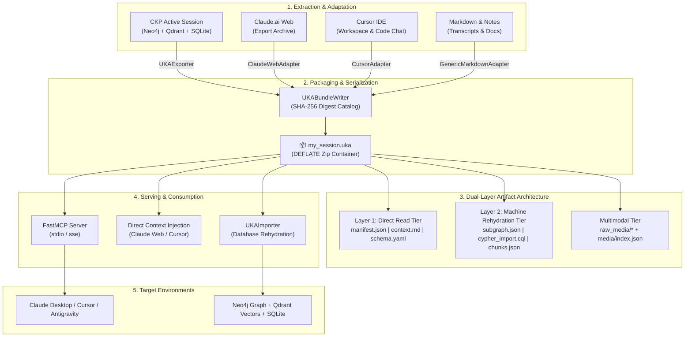

# Universal Knowledge Artifact (`.uka`) — Flow & Lifecycle Guide

The **Universal Knowledge Artifact (`.uka`)** is an open, portable, vendor-agnostic container standard designed to eliminate "context lock-in" across modern AI platforms. 

Modern AI systems—including **Claude.ai (Web)**, **Claude Desktop**, **Cursor IDE**, **Antigravity IDE**, **ChatGPT**, and proprietary enterprise SaaS platforms—trap conversational knowledge, multimodal attachments, active entity subgraphs, and vector embeddings in siloed databases. 

The `.uka` format establishes a self-describing, cryptographically verifiable, content-addressed bundle packaging:
1. **Conversational History & Infinite Distilled Memory** (Canonical turns, key decisions, open questions)
2. **Deterministic Knowledge Graph Subgraphs** (Neo4j nodes, edges, properties, and executable Cypher statements)
3. **Semantic Vector Chunks & Embeddings** (Qdrant chunks, dense IEEE 754 float32 vectors, provenance)
4. **Palantir-Style Domain Ontology Schemas** (Self-describing YAML entity definitions & relations)
5. **Multimodal Media with Pre-computed Companions** (Audio transcripts, OCR, slide summaries)

---

## 🔄 The Complete UKA Flow & Lifecycle



---

## 📁 Physical Container Directory Structure

A `.uka` archive uses DEFLATE compression (`application/x-uka+zip`) with zero operating system dependencies:

```
my_session.uka
├── manifest.json              <-- [Root] Version, metadata, SHA-256 hashes, modality flags
├── context.md                 <-- [Layer 1: Direct Read] Human- & LLM-ready markdown distillation
├── ontology/
│   └── schema.yaml            <-- [Layer 1: Grounding] Palantir-style domain ontology & rules
├── conversations/
│   ├── transcript.json        <-- Full conversational turns with role and timestamps
│   └── distilled_memory.json  <-- Extracted entities, confirmed decisions, open questions
├── graph/
│   ├── subgraph.json          <-- [Layer 2: Rehydration] Graph nodes, relationships, properties
│   └── cypher_import.cql      <-- Executable Cypher script to restore Neo4j graph state
├── vectors/
│   ├── chunks.json            <-- Text chunks + document IDs + provenance metadata
│   └── embeddings.bin         <-- Compact IEEE 754 float32 binary embeddings (optional)
└── media/                     <-- [Multimodal Dual Representation]
    ├── index.json             <-- Pre-computed transcripts, OCR, slide summaries, diarization
    ├── sample_scan.png        <-- Content-addressed binary asset
    ├── protocol_deck.pptx     <-- Content-addressed binary asset
    └── intake_audio.wav       <-- Content-addressed binary asset
```

---

## 🚀 Lifecycle Stages in Code

### 1. Programmatic Bundle Creation (`UKABundleWriter`)

```python
from uka.bundle_writer import UKABundleWriter
from uka.models import (
    UKABundleData,
    UKAManifest,
    UKAMessage,
    UKAGraphNode,
    UKAGraphEdge,
    UKASubgraph,
    UKAVectorChunk,
)

# 1. Build manifest metadata
manifest = UKAManifest(
    artifact_id="uka_cardio_101",
    title="Cardiology Clinical Review",
    description="Lisinopril contraindication assessment and trial findings.",
    modalities=["text", "graph", "vector"],
)

# 2. Add conversational messages
messages = [
    UKAMessage(role="user", content="What are the contraindications for Lisinopril?"),
    UKAMessage(role="assistant", content="Lisinopril is contraindicated in patients with a history of angioedema."),
]

# 3. Add graph nodes & relationships
nodes = [
    UKAGraphNode(id="med_001", labels=["Medication"], properties={"name": "Lisinopril"}),
    UKAGraphNode(id="cond_002", labels=["Condition"], properties={"name": "Angioedema"}),
]
edges = [
    UKAGraphEdge(id="rel_01", type="CONTRAINDICATED_IN", source="med_001", target="cond_002"),
]

# 4. Assemble bundle data
bundle_data = UKABundleData(
    manifest=manifest,
    context_md="# Cardiology Clinical Review\nLisinopril is contraindicated in angioedema.",
    messages=messages,
    subgraph=UKASubgraph(nodes=nodes, edges=edges),
)

# 5. Write to .uka archive atomically
writer = UKABundleWriter()
out_path = writer.write(bundle_data, "cardiology.uka")
print(f"Created bundle: {out_path}")
```

---

### 2. Random-Access Reading & Cryptographic Verification (`UKABundleReader`)

The `UKABundleReader` allows inspection without unpacking the entire archive to disk:

```python
from uka.bundle_reader import UKABundleReader

reader = UKABundleReader("cardiology.uka")

# 1. Cryptographic SHA-256 integrity verification
is_valid, errors = reader.verify_integrity()
if not is_valid:
    raise ValueError(f"Bundle corrupted or tampered: {errors}")

# 2. Read manifest metadata
manifest = reader.read_manifest()
print(f"Artifact: {manifest.title} ({manifest.artifact_id})")

# 3. Direct Layer 1 markdown for zero-shot LLM injection
context_md = reader.read_context_markdown()

# 4. In-memory graph exploration (no Neo4j required)
subgraph = reader.read_subgraph()
for node in subgraph.nodes:
    print(f"Node: {node.labels} -> {node.properties}")
```

---

### 3. Bidirectional Database Rehydration (`UKAImporter`)

The `UKAImporter` merges the `.uka` archive into clean target databases:

```python
from uka.importer import UKAImporter
from neo4j import GraphDatabase
from qdrant_client import QdrantClient

neo4j_driver = GraphDatabase.driver("bolt://localhost:7687", auth=("neo4j", "password"))
qdrant_client = QdrantClient(url="http://localhost:6333")

importer = UKAImporter(
    neo4j_driver=neo4j_driver,
    qdrant_client=qdrant_client,
    media_storage_dir="data/media",
)

result = importer.import_bundle("cardiology.uka", verify_integrity=True)
print(f"Nodes restored: {result['nodes_restored']}")
print(f"Edges restored: {result['edges_restored']}")
print(f"Vectors restored: {result['vectors_restored']}")
```

---

### 4. Ecosystem Adapters

Convert third-party external chat exports and notes into canonical `.uka` packages:

#### Ingesting Claude.ai Export Archives (`ClaudeWebAdapter`)
```python
from uka.adapters import ClaudeWebAdapter

adapter = ClaudeWebAdapter()
bundle_path = adapter.adapt(
    source="path/to/claude_export/conversations.json",
    output_path="claude_session.uka",
    session_id="optional-specific-uuid",
)
```

#### Ingesting Cursor IDE Workspace Chats (`CursorAdapter`)
```python
from uka.adapters import CursorAdapter

adapter = CursorAdapter()
bundle_path = adapter.adapt(
    source="path/to/cursor_chat.md",
    output_path="cursor_session.uka",
    title="Feature Implementation Session",
)
```

#### Ingesting Markdown Documents & Meeting Notes (`GenericMarkdownAdapter`)
```python
from uka.adapters import GenericMarkdownAdapter

adapter = GenericMarkdownAdapter()
bundle_path = adapter.adapt(
    source="path/to/research_notes.md",
    output_path="research_notes.uka",
)
```

---

### 5. Running the UKA FastMCP Server

Serve `.uka` bundles directly to Claude Desktop, Cursor, or external agents over the Model Context Protocol:

```bash
# STDIO transport (for Claude Desktop / Cursor configuration)
uv run uka-mcp --transport stdio

# SSE transport (for network-accessible agents)
uv run uka-mcp --transport sse --port 8008
```

#### Claude Desktop Configuration (`claude_desktop_config.json`):
```json
{
  "mcpServers": {
    "uka": {
      "command": "uv",
      "args": ["run", "--package", "ckp-uka-mcp-server", "uka-mcp", "--transport", "stdio"]
    }
  }
}
```

---

## 🌐 Platform REST API Endpoints

- **Export Active Session**:
  `GET /api/v2/sessions/{session_id}/export/uka`  
  *Response*: `application/x-uka+zip` binary stream attachment.

- **Import External Bundle**:
  `POST /api/v2/uka/import`  
  *Form-Data*: `file: <binary .uka archive>`  
  *Response*:
  ```json
  {
    "status": "success",
    "session_id": "uka_cardio_101",
    "nodes_restored": 28,
    "edges_restored": 34,
    "vectors_restored": 42,
    "messages_restored": 14,
    "media_files_saved": 3
  }
  ```

---

## 🖥️ React UI Drag-and-Drop Rehydration

The React frontend (`platform-app/frontend-react/`) includes:
- **Export .UKA Toolbar Button**: One-click download of the active conversation, Neo4j entities, and Qdrant vectors.
- **Import .UKA Sidebar & Toolbar Modal**:
  - Dark-mode glassmorphic drag-and-drop file upload.
  - Verification & progress indicator.
  - Restoration statistics grid showing restored nodes, edges, vectors, and messages.
  - Direct "Open Rehydrated Session" navigation.
