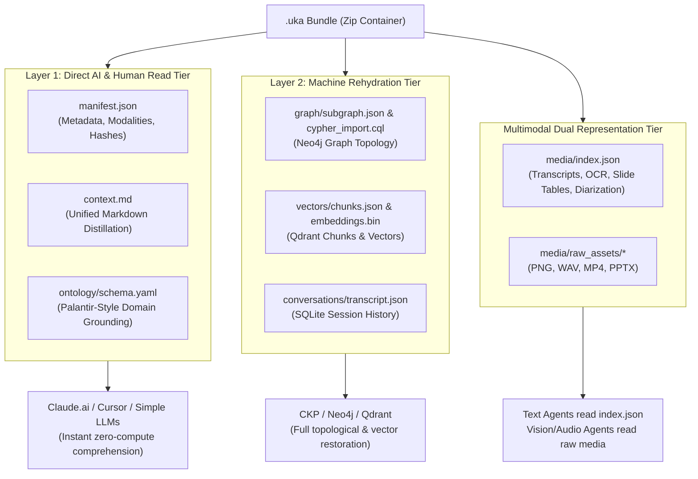

# Universal Knowledge Artifact (`.uka`) Specification
**Version:** 0.1.0  
**Status:** Draft / Active Implementation  
**MIME Type:** `application/x-uka+zip`  
**File Extension:** `.uka`  

---

## 1. Abstract & Vision

The **Universal Knowledge Artifact (`.uka`)** is an open, portable, vendor-agnostic container standard designed to eliminate "context lock-in" across AI platforms. 

Modern AI ecosystems—including **Claude.ai (Web)**, **Claude Desktop**, **Cursor IDE**, **Antigravity IDE**, **ChatGPT**, and proprietary enterprise platforms—trap conversational knowledge, multimodal attachments, active entity subgraphs, and vector embeddings in siloed databases. 

The `.uka` standard establishes a self-describing, content-addressed bundle that packages:
1. **Conversational History & Distilled Infinite Memory**
2. **Deterministic Knowledge Graph Subgraphs (Nodes, Edges, Properties)**
3. **Semantic Vector Chunks & Embeddings**
4. **Palantir-Style Domain Ontology Schemas**
5. **Multimodal Media with Pre-computed Transcripts, OCR, and Slide Summaries**

A `.uka` artifact can be inspected directly by human readers, injected into raw LLM context windows, served over the **Model Context Protocol (MCP)** to external AI agents, or rehydrated with complete fidelity into native graph and vector databases (such as Neo4j and Qdrant).

---

## 2. Container Architecture & Compression

A `.uka` file is physically structured as a **standard ZIP archive using DEFLATE compression**. 

### Architectural Guarantees:
- **Zero-Dependency Native Decompression**: Native operating systems (macOS, Windows, Linux) and browsers (via JSZip or Web Streams) can inspect or unpack a `.uka` without custom binary decoders.
- **75%–85% Compression Efficiency**: Text files (`manifest.json`, `context.md`, `schema.yaml`, `subgraph.json`) compress down to a fraction of their original size.
- **Random Access / Streaming Read**: Consumers do not need to unpack the entire archive to disk. Using streaming zip headers, an agent or MCP server can selectively read `manifest.json` (a few kilobytes) or fetch a single media file on demand.

```
my_session.uka (Zip Container)
├── manifest.json              <-- [Root] Version, metadata, SHA-256 hashes, modality flags
├── context.md                 <-- [Layer 1: Direct Read] Human- & LLM-ready markdown distillation
├── ontology/
│   └── schema.yaml            <-- [Layer 1: Grounding] Palantir-style domain ontology & rules
├── conversations/
│   ├── transcript.json        <-- Full conversational turns with role and timestamps
│   └── distilled_memory.json  <-- Extracted entities, confirmed decisions, open questions
├── graph/
│   ├── subgraph.json          <-- [Layer 2: Rehydration] Graph nodes, relationships, properties
│   └── cypher_import.cql      <-- Executable Cypher script to restore Neo4j graph state
├── vectors/
│   ├── chunks.json            <-- Text chunks + document IDs + provenance metadata
│   └── embeddings.bin         <-- Compact IEEE 754 float32 binary embeddings (optional)
└── media/                     <-- [Multimodal Dual Representation]
    ├── index.json             <-- Pre-computed transcripts, OCR, slide summaries, diarization
    ├── img_9a8f2c.png         <-- Content-addressed binary asset
    ├── slide_deck_4b1e.pptx   <-- Content-addressed binary asset
    └── audio_7d3c.wav         <-- Content-addressed binary asset
```

---

## 3. Dual-Layer Bundle Design

To support both **lightweight prompt injection** (e.g. uploading a `.uka` to Claude Web) and **heavy database rehydration** (e.g. loading into an enterprise Neo4j/Qdrant cluster), the artifact is split into two distinct tiers:



---

## 4. File-by-File Technical Specification

### 4.1 Root Manifest (`manifest.json`)
The root metadata descriptor. Must be located at the root of the ZIP container.

```json
{
  "uka_version": "0.1.0",
  "artifact_id": "uka_20261020_7f8a9b1c",
  "created_at": "2026-10-20T01:30:00Z",
  "generator": {
    "name": "Cognitive Knowledge Platform",
    "version": "3.0.0",
    "origin": "session_cad49e10"
  },
  "title": "Cardiology Clinical Intake & Trial Analysis",
  "description": "Multi-modal patient consultation with ECG rhythm strips and trial protocol deck.",
  "modalities": ["text", "graph", "vector", "vision", "audio", "presentation"],
  "stats": {
    "total_turns": 14,
    "graph_nodes": 28,
    "graph_edges": 34,
    "vector_chunks": 42,
    "media_assets": 3,
    "uncompressed_bytes": 6245120
  },
  "content_hashes": {
    "context.md": "sha256:4b1e8a9f...",
    "ontology/schema.yaml": "sha256:9c2b1a0f...",
    "graph/subgraph.json": "sha256:7f8a9b1c...",
    "vectors/chunks.json": "sha256:1a2b3c4d...",
    "media/index.json": "sha256:e5f6a7b8..."
  }
}
```

---

### 4.2 Unified Markdown Context (`context.md`)
A self-contained markdown document synthesizing the entire artifact. When a user drags a `.uka` into Claude Web, ChatGPT, or Cursor, this is the primary file ingested into the prompt window.

It includes:
- Executive Summary & Session Objectives
- Active Key Entities (pulled from graph)
- Attached Media with inline text captions & transcripts
- Distilled decisions and action items
- Full conversation transcript

---

### 4.3 Self-Describing Ontology (`ontology/schema.yaml`)
Enforces strict Palantir-style entity and relationship governance. It tells external AI models the exact semantic definition of every node label, relationship type, and property:

```yaml
version: "1.0.0"
domain: "healthtech"
description: "Clinical patient care, diagnosis, and medication ontology."

entity_types:
  Patient:
    description: "An individual receiving clinical diagnosis and care."
    properties:
      id: { type: "string", primary_key: true }
      mrn: { type: "string", description: "Medical Record Number" }
      age: { type: "integer" }
      gender: { type: "string" }
  Disease:
    description: "A pathological condition or ICD-10 diagnosis."
    properties:
      id: { type: "string", primary_key: true }
      name: { type: "string" }
      icd10: { type: "string" }
  Medication:
    description: "A pharmaceutical drug prescribed to a patient."
    properties:
      id: { type: "string", primary_key: true }
      name: { type: "string" }
      dosage: { type: "string" }

relationship_types:
  HAS_DIAGNOSIS:
    source: "Patient"
    target: "Disease"
    description: "Connects a patient to an identified medical condition."
    properties:
      diagnosed_date: { type: "string" }
      confidence: { type: "float" }
  PRESCRIBED:
    source: "Patient"
    target: "Medication"
    description: "Connects a patient to an active drug prescription."
    properties:
      start_date: { type: "string" }
      status: { type: "string" }
```

---

### 4.4 Graph Topology (`graph/subgraph.json` & `graph/cypher_import.cql`)
Represents the knowledge graph extracted during the session.

- **`subgraph.json`**:
```json
{
  "nodes": [
    {
      "id": "patient_001",
      "labels": ["Patient"],
      "properties": {"name": "Alice Smith", "mrn": "MRN-98412", "age": 54}
    },
    {
      "id": "disease_002",
      "labels": ["Disease"],
      "properties": {"name": "Type 2 Diabetes", "icd10": "E11.9"}
    }
  ],
  "edges": [
    {
      "id": "rel_001",
      "type": "HAS_DIAGNOSIS",
      "source": "patient_001",
      "target": "disease_002",
      "properties": {"diagnosed_date": "2026-03-12", "confidence": 0.95}
    }
  ]
}
```

- **`cypher_import.cql`**:
```cypher
MERGE (n1:Patient {id: 'patient_001'}) SET n1.name = 'Alice Smith', n1.mrn = 'MRN-98412', n1.age = 54;
MERGE (n2:Disease {id: 'disease_002'}) SET n2.name = 'Type 2 Diabetes', n2.icd10 = 'E11.9';
MERGE (n1)-[r:HAS_DIAGNOSIS {diagnosed_date: '2026-03-12', confidence: 0.95}]->(n2);
```

---

### 4.5 Multimodal Dual-Representation (`media/` & `media/index.json`)
Solves the problem of multimodal comprehension across heterogeneous AI models.

Every media asset contains:
1. **Raw Binary File**: `media/<filename>`
2. **Pre-computed Semantic Index**: `media/index.json`

```json
{
  "version": "1.0.0",
  "assets": [
    {
      "asset_id": "audio_7d3c",
      "filename": "audio_7d3c.wav",
      "mime_type": "audio/wav",
      "sha256": "7d3ca1b4e...",
      "size_bytes": 1048576,
      "modality": "audio",
      "summary": "Cardiology intake consultation discussing acute chest pressure.",
      "extracted_content": {
        "duration_seconds": 42.5,
        "speakers": ["Doctor", "Patient"],
        "transcript": "Doctor: How long have you felt this pressure? Patient: Since yesterday evening.",
        "diarized_segments": [
          {"start": 0.0, "end": 3.2, "speaker": "Doctor", "text": "How long have you felt this pressure?"},
          {"start": 3.5, "end": 7.1, "speaker": "Patient", "text": "Since yesterday evening."}
        ]
      }
    },
    {
      "asset_id": "deck_4b1e",
      "filename": "slide_deck_4b1e.pptx",
      "mime_type": "application/vnd.openxmlformats-officedocument.presentationml.presentation",
      "sha256": "4b1ee890a...",
      "size_bytes": 2451200,
      "modality": "presentation",
      "summary": "Clinical trial Phase II protocol and dosage distribution deck.",
      "extracted_content": {
        "total_slides": 8,
        "slides": [
          {
            "slide_number": 1,
            "title": "Trial Protocol - Cohort Alpha",
            "body_text": "Metformin 500mg daily vs. Control group.",
            "speaker_notes": "Remind investigators to verify baseline kidney function before administration.",
            "tables": [
              {"headers": ["Dose", "Frequency", "Patients"], "rows": [["500mg", "Daily", "150"]]}
            ]
          }
        ]
      }
    },
    {
      "asset_id": "img_9a8f2c",
      "filename": "img_9a8f2c.png",
      "mime_type": "image/png",
      "sha256": "9a8f2c3d...",
      "size_bytes": 358400,
      "modality": "image",
      "summary": "Vitals monitor screenshot showing blood pressure and heart rate.",
      "extracted_content": {
        "ocr_text": "BP: 138/88 mmHg | Pulse: 78 bpm | SpO2: 98%",
        "visual_description": "Clean digital telemetry monitor display with green sinus rhythm waveform.",
        "diagram_type": "clinical_monitor"
      }
    }
  ]
}
```

---

### 4.6 Vectors & Embeddings (`vectors/chunks.json` & `vectors/embeddings.bin`)
- **`chunks.json`**:
```json
[
  {
    "chunk_id": "chk_001",
    "document_id": "doc_protocol_v2",
    "modality": "presentation",
    "page_or_slide": 1,
    "text": "Trial Protocol - Cohort Alpha: Metformin 500mg daily vs. Control group.",
    "metadata": {"section": "Dosage Guidelines", "confidence": 0.98}
  }
]
```
- **`embeddings.bin`**:
  Compact, continuous binary stream of 32-bit floating-point numbers (`float32`), packed in order of `chunk_id`. This shrinks dense vector storage by **75%** compared to JSON float arrays.

---

## 5. Security & Provenance

1. **Content-Addressing & Tamper Evidence**:
   Every file within `.uka` has its SHA-256 hash recorded in `manifest.json`. During reading or rehydration, the reader verifies that no asset has been tampered with or modified.
2. **Zero-Trust Credential Masking**:
   Before a `.uka` is generated, CKP's **Secret Scanner & Guardrails** strip all passwords, API keys, and sensitive tokens into localized session identifiers.
3. **Data Provenance**:
   Every node in `subgraph.json` and chunk in `chunks.json` includes `document_id` and provenance tracking.

---

## 6. Implementation Architecture (`packages/uka-core/`)

The Python reference implementation lives in `packages/uka-core/`:
- **`UKABundleWriter`**: Gathers metadata, subgraph, vector chunks, and media; computes SHA-256 hashes; and writes the compressed `.uka` stream.
- **`UKABundleReader`**: Inspects archives, reads manifests, streams individual files on demand.
- **`UKAImporter`**: Connects to active Neo4j, Qdrant, and SQLite instances to rehydrate the bundle with zero data loss.
